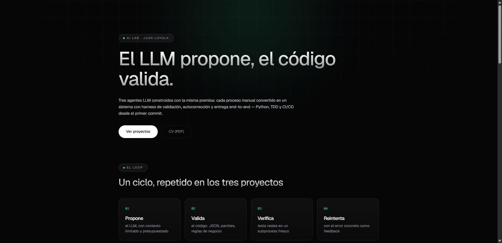

# AI Lab — hub del portfolio

Una sola página que presenta los tres agentes del portfolio: qué hacen en
lenguaje de negocio, qué demuestra cada uno y cómo probarlos. Hecha con
Next.js 15 + Tailwind v4 y el design system **Minimal** (dark-first, grid
sutil + glow, tipografía Geist, motion con `Reveal`/`WordReveal`).



## Por qué existe

Los proyectos son backend puro: sin algo así, la única forma de "probarlos"
es clonar y correr en terminal, y eso nadie lo hace. El hub resuelve eso:

- **invoice-agent** → embed del **Swagger UI** en vivo (interactivo, sin deploy del viewer) + demo de video de la API
- **slack-triage-bot** y **code-agent** → slots para **demos en video** (MP4) con fallback al repo
- **El loop de autocorrección** (`Propone → Valida → Verifica → ↺`) como pieza central: es la idea que los tres proyectos comparten

## Correr local

```bash
npm install
npm run dev        # http://localhost:3000
```

## Deploy (Vercel)

1. Subir el folder a GitHub.
2. En Vercel: *New Project* → importar el repo → Deploy (no necesita config).
3. Variables de entorno (opcionales):

| Var | Para qué | Ejemplo |
|---|---|---|
| `NEXT_PUBLIC_INVOICE_URL` | Si la seteás, la card de invoice-agent muestra el Swagger embebido en vez del link de fallback | `https://invoice-agent.onrender.com/docs` |

## Agregar los demos

- **Videos**: dejar los archivos en `public/demos/` con los nombres
  `invoice-agent.mp4`, `slack-triage.mp4` y `code-agent.mp4` (o cambiar los
  nombres en `lib/projects.ts`); el flag `video.ready` se pone en `true` a
  mano cuando el archivo existe — mientras sea `false`, el slot muestra el
  fallback al repo, nunca un tile roto.
- **Swagger**: deployar invoice-agent (Render/Railway/Fly, gratis) y setear
  `NEXT_PUBLIC_INVOICE_URL` con la URL de `/docs`.

## Estructura

```
hub/
├── app/
│   ├── layout.tsx       # metadata + lang es
│   ├── page.tsx         # la única pantalla: hero, loop, proyectos, footer
│   └── globals.css      # tokens Minimal (colores, tipografía, grid + glow)
├── components/
│   ├── Background.tsx   # grid + glow de fondo (aria-hidden)
│   ├── motion.tsx       # Reveal / WordReveal (IntersectionObserver)
│   └── ProjectCard.tsx  # card + DemoSlot (swagger | video | fallback)
├── lib/
│   └── projects.ts      # TODO el contenido: editar acá, no en los componentes
└── public/
    ├── cv.pdf
    └── demos/           # *.mp4 + *.jpg (posters)
```

**Para cambiar texto, links o demos: `lib/projects.ts`.** Los componentes no
tienen contenido hardcodeado.

## Decisión de diseño

El hub es **estático** (Next.js prerender → 103 kB de JS). No hay backend, no
hay CMS, no hay base de datos: es un portfolio, y agregarle infra sería
contraproducente. El único "estado" son variables de entorno de build.

---

Juan Loyola · [LinkedIn](https://www.linkedin.com/in/loyolajuan) · jloyoladev@gmail.com
